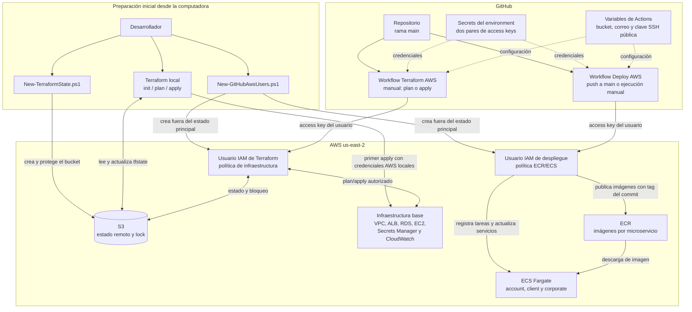
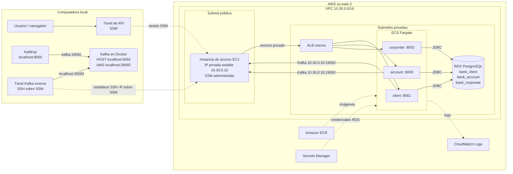
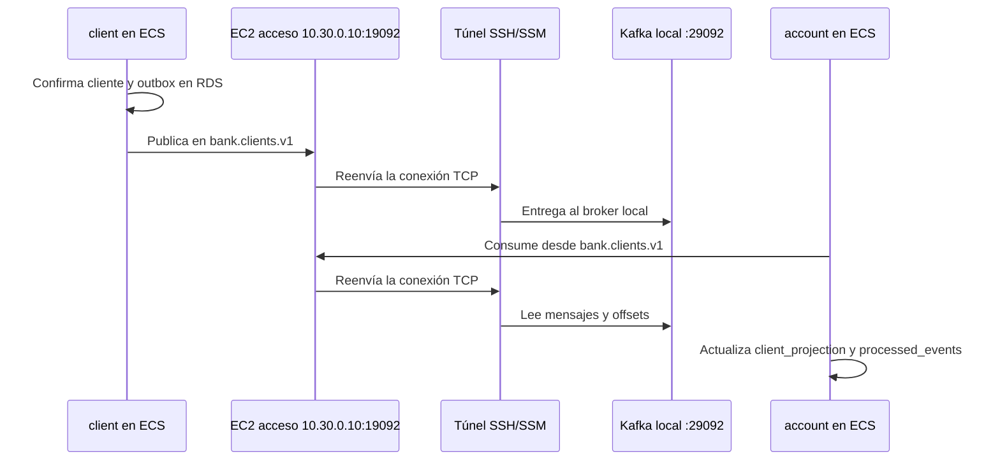

# Arquitectura y operación

## Separación y consistencia

Cada microservicio tiene sus entidades JPA, repositorios, servicios, DTO y base PostgreSQL. `corporate` administra `catalog_types`, `catalog_values` y `work_areas`. Los tipos de catálogo se identifican mediante sus IDs: documento 1, cuenta 2, transacción 3 y área de trabajo 4. `catalog_types` no tiene una columna de código. También se incluyen una matriz y tres sucursales. No hay consultas entre bases ni llamadas REST entre servicios para validar esas referencias: `client` y `account` almacenan únicamente los IDs externos.

`Person` es una entidad raíz abstracta con tabla `persons` y herencia JPA `JOINED`. `Client extends Person` usa la tabla `clients`: `clients.id` es simultáneamente PK y FK a `persons.id`, por lo que cada cliente tiene exactamente una persona y una persona admite como máximo un cliente. La relación uno a uno se materializa mediante `@PrimaryKeyJoinColumn`; no se añade una asociación `@OneToOne` redundante. Los datos personales y la versión optimista están en `persons`; `password` e `isActive` están en `clients`. Las entidades no se serializan directamente desde los controllers.

`client` escribe el cliente y su outbox dentro de una misma transacción. Un publicador periódico selecciona hasta 100 pendientes con `FOR UPDATE SKIP LOCKED`, publica y espera confirmación Kafka antes de marcar los registros. Si Kafka falla, la transacción se revierte y los registros siguen pendientes. Un fallo después de publicar pero antes de confirmar la base puede duplicar eventos: la entrega es **al menos una vez**, no exactamente una vez.

El tópico `bank.clients.v1` usa `clientId` como clave. Contrato JSON:

```json
{"schemaVersion":1,"eventId":"aab56c4a-964f-45ec-871f-36dde4876433","clientId":1,"version":0,"name":"Ana","active":true}
```

`version` corresponde a la versión optimista JPA del cliente. Solo se transportan los datos que necesita account; no se publican contraseña, DNI, teléfono ni dirección. El consumidor guarda la proyección y el identificador procesado atómicamente. Ignora duplicados y snapshots anteriores; un evento antiguo no reactiva un cliente dado de baja. El orden físico de publicación del outbox no es un contrato; los snapshots completos y su versión permiten converger al último estado.

El consumidor confirma el registro después de confirmar PostgreSQL. Los errores reintentables tienen tres reintentos con espera de un segundo; después se envían a `<topic>.DLT`. Los errores clasificados como fatales por Spring Kafka pueden ir directamente a DLT. Si falla la publicación en DLT, no se considera recuperado el registro. Un operador debe inspeccionar el motivo, corregir el productor/dato y republicar el evento con su clave original. No existe replay automático de DLT.

La eliminación de clientes es lógica: registra `deleted_at` y desactiva `is_active`. Account rechaza nuevas operaciones después de recibir su baja; durante la propagación existe una ventana de consistencia eventual. No se promete una prohibición inmediata global. La información de cliente en los reportes refleja la proyección vigente, no su nombre histórico.

## Movimientos

Las transacciones de dinero bloquean la fila de la cuenta con `PESSIMISTIC_WRITE`. Todas las escrituras de saldo pasan por ese bloqueo. Una edición o baja bloquea la cuenta y vuelve a leer el movimiento original para impedir que dos peticiones reviertan el mismo movimiento. Original, compensación, reemplazo y saldo se confirman o revierten juntos.

Los importes usan `NUMERIC(19,2)`/`BigDecimal`. Las restricciones SQL complementan las validaciones del servicio. Los identificadores son internos y no representan un número de cuenta. Los reportes usan una transacción `REPEATABLE_READ` para que las distintas consultas compartan una instantánea consistente.

Las cuentas guardan `account_type_id`, `work_area_id` y `account_created_at`. Cada movimiento guarda `transaction_type_id` y el `work_area_id` donde se originó. Los valores `301` y `302` representan depósito y retiro; el servicio y la restricción SQL controlan que el signo coincida. Las tablas `persons`, `accounts` y `transactions` indexan sus referencias externas para las consultas que las filtren, aunque PostgreSQL no pueda declarar una FK entre bases diferentes.

Los POST de movimientos no implementan una clave de idempotencia de negocio: el consumidor Kafka sí es idempotente, pero repetir una solicitud HTTP POST exitosa crea otro movimiento. Un cliente HTTP debe confirmar el resultado antes de repetir una petición cuya respuesta se perdió.

## Auditoría de PostgreSQL

Todas las tablas tienen `created_at` y `updated_at` con valor predeterminado `CURRENT_TIMESTAMP`. Los triggers `trg_<tabla>_updated_at_before_update` invocan `fn_set_updated_at` y mantienen la última modificación dentro de la transacción. Si fallan, propagan la excepción para que la operación sea revertida; las funciones de trigger no ejecutan ROLLBACK, que corresponde a la transacción llamadora.

`AuditedEntity` mapea los timestamps generados por PostgreSQL. En la herencia JOINED los atributos Java heredados se almacenan en `persons`; la tabla `clients` tiene además sus propios timestamps, mantenidos por defecto y trigger. No se duplican propiedades JPA para esos campos auxiliares de la subtabla.

`deleted_at` registra la baja de clientes y cuentas y se conserva al repetir una desactivación. DELETE y cualquier PUT/PATCH con `isActive=false` producen la misma baja lógica. La reactivación explícita elimina esa marca. La base rechaza un registro activo con fecha de eliminación o uno inactivo sin ella. Se conserva la auditoría por movimientos compensatorios de Transaction.

Las constraints SQL tienen nombres explícitos. Todas las FK disponen de índice completo, usando PK/UNIQUE o prefijos de índices compuestos cuando ya cubren la relación. El índice parcial del outbox se utiliza para buscar pendientes; su FK tiene además un índice completo.

## Rendimiento, escalabilidad y resiliencia

- Índices en cliente de cuenta y en cuenta/fecha/ID de movimientos. Listados paginados y JPA sin Open Session in View.
- Servicios sin estado de sesión, con pool JDBC administrado por Spring Boot. Las instancias account comparten el grupo Kafka y se reparten particiones; más instancias que particiones no añaden paralelismo de consumo.
- El bloqueo es por cuenta: cuentas diferentes pueden operar en paralelo. Mantener la atomicidad de una cuenta impone serialización para ese saldo.
- El outbox tolera caídas de Kafka y evita perder el evento tras confirmar un cliente. Mantiene bloqueos mientras espera al broker; para mayor volumen convendría CDC o un publicador con leases.
- Los reportes recuperan todos los movimientos del período: para volúmenes elevados conviene limitar rangos o incorporar generación asíncrona de reportes. No se incluyen cachés que puedan mostrar saldos desactualizados.
- Definir retención y archivo del outbox publicado y de eventos procesados antes de operar a gran escala. La retención de deduplicación debe superar la ventana máxima de replay. No se elimina historial automáticamente.
- En un despliegue productivo, configurar replicación Kafka, backups PostgreSQL, métricas de lag/outbox/DLT, alertas de fallos y límites de conexiones. Estos aspectos quedan contemplados; no se entrega una plataforma de observabilidad ni alta disponibilidad local.

## Alcance

Una moneda, clientes y cuentas sin autenticación de API, ejecución local. La contraseña de Client forma parte del modelo solicitado, no constituye un mecanismo de login. Las configuraciones de servidores externos y las credenciales se proporcionan por entorno. Las migraciones de cada servicio se aplican únicamente a su base.

# Despliegue AWS

El ambiente de desarrollo de AWS se administra con Terraform. Las tres aplicaciones se ejecutan como servicios ECS Fargate detrás de un ALB interno. RDS mantiene tres bases lógicas y credenciales independientes dentro de una instancia PostgreSQL Single-AZ. Kafka y Kafdrop permanecen en la computadora local porque MSK no está disponible en la cuenta.

## Interacción entre GitHub, Terraform y AWS



Los usuarios y sus políticas se crean mediante un bootstrap local y permanecen fuera del estado principal. Sus access keys se guardan exclusivamente como secrets del environment `development`: Terraform y despliegue usan pares distintos. El workflow de Terraform administra infraestructura y estado, mientras que el workflow de despliegue compila los tres módulos, publica imágenes inmutables en ECR y actualiza ECS.

OIDC con roles de corta duración sería la opción ideal porque evita secretos permanentes. Esta cuenta usa usuarios IAM debido a que una SCP de AWS Organizations bloquea la administración de proveedores de identidad. Si esa restricción cambia, se debe migrar a OIDC y retirar las access keys.



El flujo Kafka atraviesa el túnel en ambos sentidos aunque el reenvío se establezca desde la computadora:



Las flechas punteadas representan administración o entrega de configuración. Las flechas continuas representan tráfico de la aplicación. La instancia de acceso no ejecuta Kafka: recibe conexiones privadas de ECS en `19092` y las reenvía al listener `29092` del Kafka local. `corporate` solo usa PostgreSQL y no participa en Kafka.

Las APIs se alcanzan por un túnel de Systems Manager. Un segundo túnel SSH inverso, transportado por Session Manager, publica el listener local `localhost:29092` en el puerto privado `19092` de la instancia de acceso. Ese puerto solo acepta tráfico del security group de ECS; SSH y Kafka no tienen puertos públicos de entrada. RDS acepta únicamente los grupos de seguridad de ECS y administración. Secrets Manager entrega las credenciales de base de datos a las tareas; los secrets de GitHub contienen únicamente las credenciales de automatización AWS.

Las tareas `client` y `account` reciben el endpoint privado del túnel en `KAFKA_BOOTSTRAP_SERVERS`. El broker anuncia listeners distintos para Docker local, Windows y ECS. El patrón outbox, el consumo idempotente, el tópico principal, el DLT y el grupo `bank-account-v1` conservan el mismo contrato. Si se corta el túnel, los eventos permanecen pendientes en el outbox y el consumidor retoma sus offsets al recuperar la conexión.
