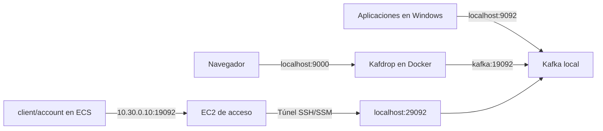
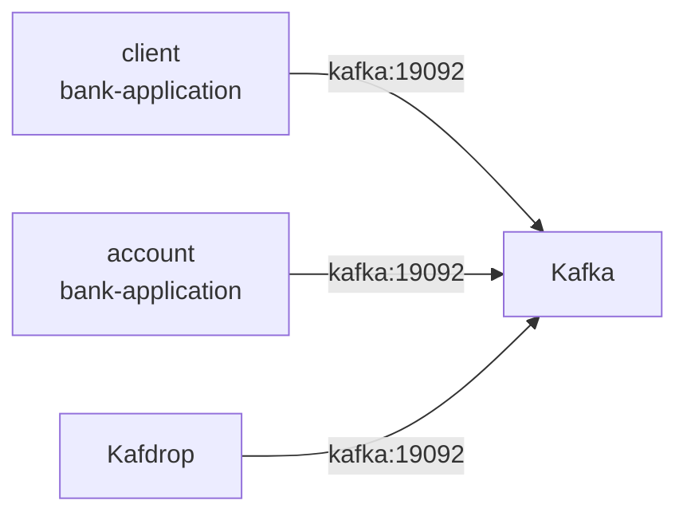

## Explicación de puertos que maneja kafka y kafdrop

Kafka usa varios puertos porque cada tipo de cliente necesita una dirección distinta. Es el mismo broker Kafka, con tres listeners de acceso y uno interno de control.

| Puerto | Dónde existe | Quién lo usa | Dirección de conexión |
|---|---|---|---|
| `9092` | Windows → contenedor Kafka | Microservicios y pruebas ejecutados en Windows | `localhost:9092` |
| `19092` | Red interna de Docker | Kafdrop y otros contenedores locales | `kafka:19092` |
| `29092` | Windows → contenedor Kafka | Destino local del túnel inverso hacia AWS | `localhost:29092` |
| `9093` | Solo dentro del contenedor | Controlador interno de Kafka en modo KRaft | No debes conectarte manualmente |
| `9000` | Windows → contenedor Kafdrop | Interfaz web de Kafdrop | `http://localhost:9000` |

### Puerto 9092: aplicaciones en Windows

Esta publicación del Compose:

```yaml
ports:
  - "127.0.0.1:9092:9092"
```

significa:

```text
Windows localhost:9092 → Kafka dentro del contenedor:9092
```

Por eso, si ejecutas `client` o `account` directamente con Maven en Windows, debes configurar:

```yaml
spring:
  kafka:
    bootstrap-servers: localhost:9092
```

### Puerto 19092: comunicación entre contenedores

Kafka escucha internamente en:

```text
kafka:19092
```

Kafdrop usa precisamente esa dirección:

```yaml
KAFKA_BROKERCONNECT: kafka:19092
```

Aquí `kafka` es el nombre DNS del contenedor. Kafdrop puede resolverlo porque ambos contenedores están dentro de la misma red Docker.

El puerto `19092` no está publicado directamente en Windows. Por eso normalmente no debes intentar usar:

```text
localhost:19092
```

### Puerto 29092: entrada al Kafka local desde el túnel AWS

Kafka también publica:

```yaml
ports:
  - "127.0.0.1:29092:29092"
```

El túnel inverso conecta:

```text
EC2 10.30.0.10:19092 → túnel SSH/SSM → Windows localhost:29092
```

Los servicios ECS usan:

```text
KAFKA_BOOTSTRAP_SERVERS=10.30.0.10:19092
```

Aunque ECS ve el puerto `19092`, la conexión termina realmente en el listener `29092` del Kafka que se ejecuta en tu computadora.



### Puerto 9093: controlador KRaft

Kafka está funcionando sin ZooKeeper, en modo KRaft. El puerto `9093` lo utiliza internamente para las funciones de controlador:

```yaml
CONTROLLER://0.0.0.0:9093
```

No está en `ports`, por lo que no se expone a Windows ni a AWS.

### Puerto 9000: interfaz de Kafdrop

Esta línea:

```yaml
ports:
  - "9000:9000"
```

publica la interfaz web de Kafdrop. Puedes abrirla en:

[http://localhost:9000](http://localhost:9000)

Kafdrop no recibe mensajes mediante el puerto `9000`. Ese puerto sirve solamente para la página web; Kafdrop se comunica con Kafka mediante `kafka:19092`.

La regla práctica es:

- Ejecutas Java en Windows: `localhost:9092`.
- Ejecutas una aplicación en Docker junto con Kafka: `kafka:19092`.
- Ejecutas `account` o `client` en AWS: `10.30.0.10:19092`, con el túnel activo.
- Abres Kafdrop en el navegador: `localhost:9000`.


## account o client desde el contendor "bank-application" localmente usará el puerto 19092
Sí. Cuando `account` o `client` se ejecutan como contenedores del proyecto `bank-application`, usan por defecto:

```text
kafka:19092
```

El `compose.yml` define:

```yaml
KAFKA_BOOTSTRAP_SERVERS: ${KAFKA_BOOTSTRAP_SERVERS:-kafka:19092}
```

Esto significa:

- Si no defines `KAFKA_BOOTSTRAP_SERVERS`, usa `kafka:19092`.
- Si defines esa variable, usa el valor proporcionado.

Además, ambos servicios se conectan a la red externa:

```yaml
kafka-network:
  external: true
  name: kafka_default
```

El Compose de Kafka crea esa red porque tiene:

```yaml
name: kafka
```

Docker normalmente genera la red `kafka_default`. Dentro de esa red, el nombre `kafka` resuelve la IP del contenedor Kafka.



El orden correcto es:

```powershell
docker compose -f infra/local-kafka/compose.yml up -d
docker compose up -d --build
```

Puedes comprobar que la red existe con:

```powershell
docker network inspect kafka_default
```

Y revisar qué dirección recibió cada microservicio con:

```powershell
docker compose exec account printenv KAFKA_BOOTSTRAP_SERVERS
docker compose exec client printenv KAFKA_BOOTSTRAP_SERVERS
```

Los dos deberían mostrar:

```text
kafka:19092
```

En este escenario no debes configurar `localhost:9092`: dentro del contenedor, `localhost` apunta al propio contenedor de `account` o `client`, no al contenedor Kafka.